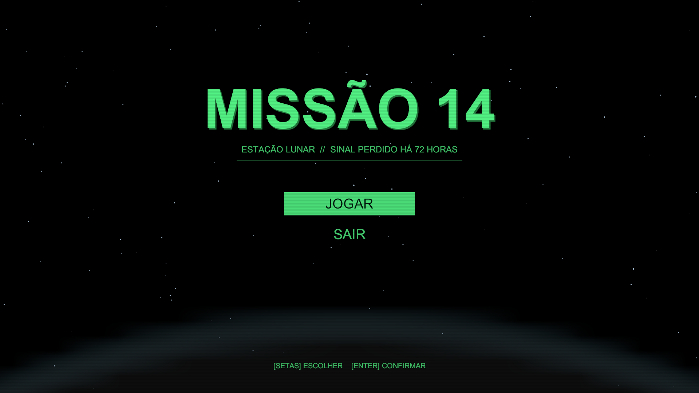
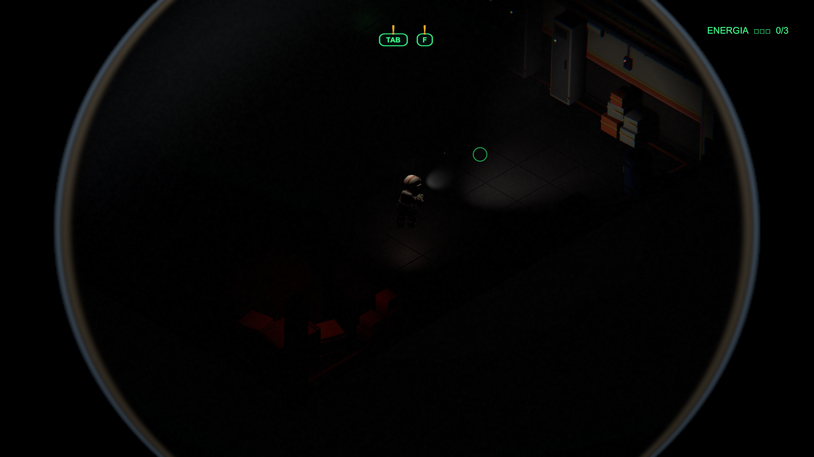
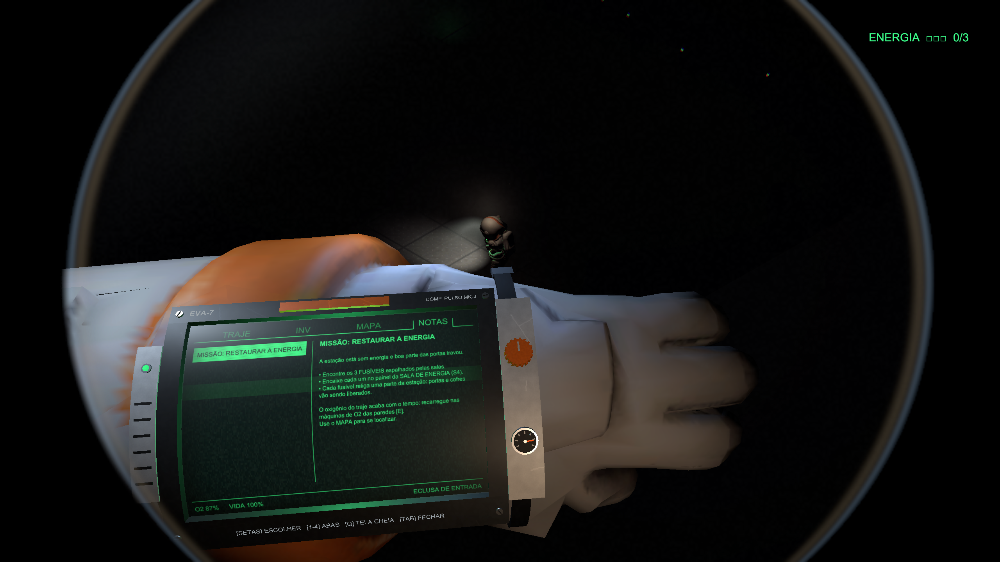
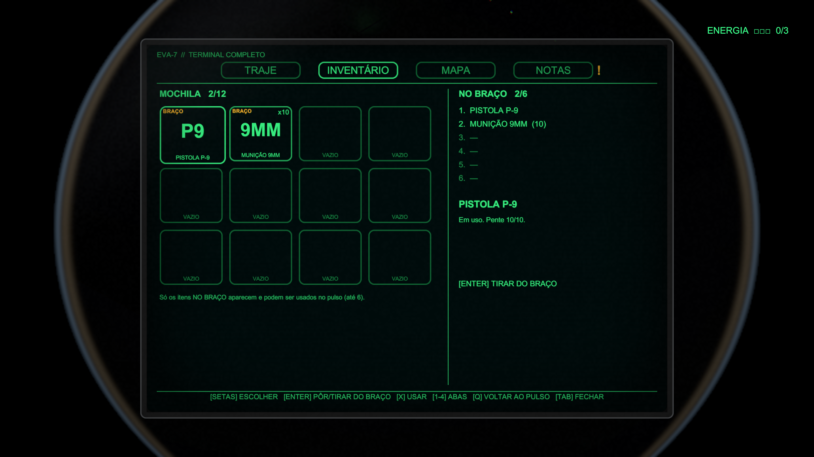
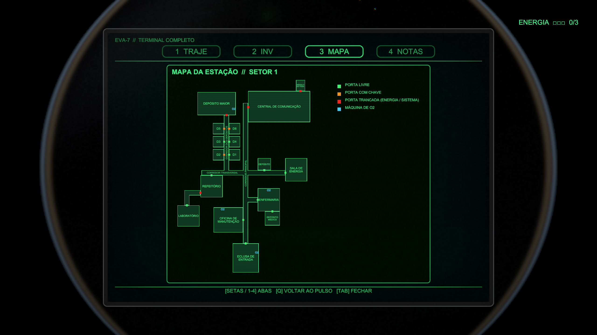

# MISSÃO 14

**Survival horror isométrico numa estação lunar abandonada.**

O sinal da estação foi perdido há 72 horas. Você chega sozinho, de traje, com uma pistola e um computador de pulso — e a energia está cortada. Encontre os fusíveis, religue a estação, descubra o que aconteceu e mande o pedido de resgate antes que o oxigênio (ou algo pior) acabe.

> ⚠️ **Versão de teste (demo).** Contém a primeira fase. Feito em Unity 6 (URP).

---

## ⬇️ Baixar e jogar

1. Vá em **[Releases](../../releases/latest)** e baixe o arquivo **`Missao14_Windows.zip`**.
2. **Extraia o zip inteiro** numa pasta (botão direito → *Extrair tudo...*).
   O jogo precisa da pasta completa — só o `.exe` sozinho não abre.
3. Abra **`Missao14.exe`**.

**O Windows mostrou "O Windows protegeu o computador"?**
É normal: o jogo não tem assinatura digital paga. Clique em **Mais informações → Executar assim mesmo**.

### Requisitos
- Windows 10 ou 11 (64 bits)
- Placa de vídeo com DirectX 11 (testado numa GTX 1650)
- Teclado e mouse

---

## 🎮 Controles

| Ação | Tecla |
|---|---|
| Andar | **W A S D** |
| Correr | **Shift** (gasta fôlego) |
| Pular | **Espaço** |
| Mirar | **Botão direito do mouse** |
| Atirar | **Botão esquerdo** (mirando) |
| Recarregar | **R** |
| Guardar / sacar a arma | **H** |
| Interagir (portas, máquinas de O2, itens) | **E** |
| Computador de pulso (traje, inventário, mapa, notas) | **TAB** |
| Tela cheia do terminal (mochila de 12 espaços, mapa inteiro) | **Q** (com o pulso aberto) |
| Ver a arma e a munição | **F** |
| Trocar de aba | **1 – 4** ou **← →** |
| Escolher / usar | **↑ ↓** e **Enter** |
| Sair do jogo | **Alt + F4** |

---

## 🧭 Dicas

- **Não há texto de missão na tela.** O que fazer fica nas **NOTAS** do computador de pulso — quando aparecer um **"!"** em cima do **TAB**, tem nota nova.
- **O vidro do capacete é a sua tela:** correndo demais você fica sem fôlego, a respiração embaça o visor e a visão borra. Golpes de frente arranham o vidro.
- **Oxigênio acaba com o tempo.** Recarregue nas máquinas de **O2** das paredes (marcadas no mapa).
- No braço cabem só **6 itens**. Na tela cheia (**Q**) você vê a mochila inteira e escolhe quais 6 ficam no braço.
- A estação está escura. A lanterna é sua melhor amiga — e a névoa esconde coisas.

---

## 📸 Imagens

| | |
|---|---|
|  |  |
|  |  |

---

## 🐞 Encontrou um problema?

Abra uma **[Issue](../../issues)** contando o que aconteceu (e, se der, com um print). Toda opinião ajuda!

---

© Rainan Coelho. Todos os direitos reservados — este repositório serve apenas para distribuir a versão de teste do jogo.
